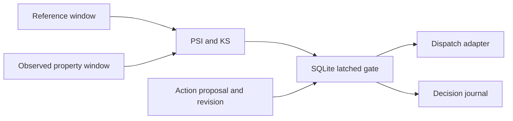

# AIP Ontology drift monitor

[](https://github.com/cankaan120/aip-ontology-drift-monitor/actions/workflows/ci.yml)

Property-window drift detection with a durable, fail-closed action gate. Integrate
the Python library between property ingestion and a downstream action dispatcher.
The adapter accepts numeric arrays; no Foundry account or SDK is required.



## Quickstart (30 Seconds)

```sh
pip install -e '.[test]'
python -c "import json; open('reference.json','w').write(json.dumps(list(range(200)))); open('observed.json','w').write(json.dumps(list(range(200))))"
ontology-drift reference.json observed.json --property radar_range
pytest -q
python benchmarks/benchmark.py
```

| Signal | Default gate threshold | Definition |
|---|---:|---|
| PSI | >= 0.20 | Reference-quantile bins, 0.5-count smoothing |
| KS | >= 0.20 | Two-sample empirical CDF distance |
| Missing/nonfinite | > 5% | Invalid windows fail closed |
| Valid samples | < 100 | Invalid windows fail closed |
| Observation age | > 300 seconds | Authorization denied |

The gate starts closed. Call `observe(report)`, then explicitly `reset(revision)`
after a healthy check. Drift or invalid reports latch it closed; subsequent healthy
reports do not silently reopen it. `authorize(ActionRequest(...))` checks freshness
and an exact gate revision and journals the decision in one SQLite transaction.
Use a separate gate/property for each protected property and require all gates.
KS is an effect-size threshold, not a multiple-testing-adjusted significance test.

## Integration contract

All downstream dispatchers must use the gate. An authorization result is a decision
at a point in time, not a lease: external execution is not atomic with SQLite.
Recheck immediately before dispatch and use idempotency at the external boundary.
The host application authenticates operators and restricts access to reset/database
files. The local journal is durable, not a tamper-proof enterprise audit service.

## Benchmark

`benchmarks/results.json` records median and p95 microseconds for two 1,000-sample
windows, excluding I/O, after one warmup. Re-run on deployment hardware.

| Window comparison | Median, microseconds | p95, microseconds |
|---|---:|---:|
| PSI + KS, 1,000 values per window | 720.95 | 816.41 |

Measured on Windows x86-64, Python 3.12.14. The SQLite gate is outside this benchmark.
Run `python examples/gated_action.py` for a complete healthy-to-blocked transition.

Pydantic rejects unknown request fields and nonfinite policy thresholds. Tests cover
incomplete healthy reports as well as
constant references, shifts, missing windows, stale observations and restart latching.
MIT. Independently implemented integration component; no platform compatibility claim.

## Development

```sh
git clone https://github.com/cankaan120/aip-ontology-drift-monitor.git
cd aip-ontology-drift-monitor
python -m venv .venv
# Activate .venv with your shell, then:
python -m pip install -e ".[test]" ruff==0.17.3 build
python -m pytest -q
python -m ruff check --select E9,F63,F7,F82 src tests
python -m ruff format --check src tests
python -m build
```

Report defects with the command, input shape or minimal fixture, and runtime version.
Regression tests should reproduce the failure and preserve the documented units.
